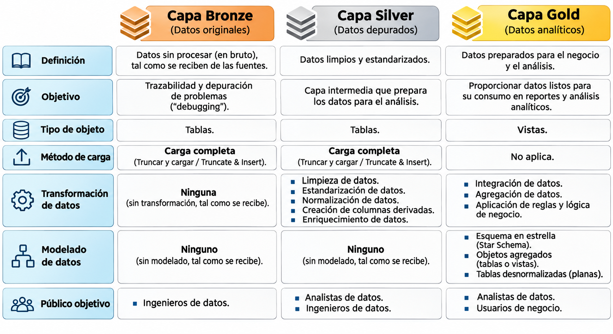
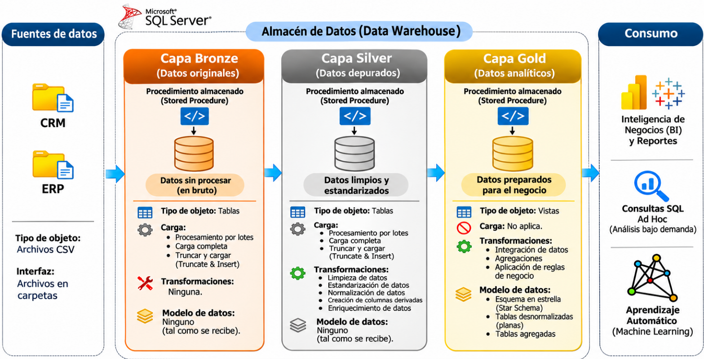

# Arquitectura

## Capas



- **Bronze:** copia fiel de los CSV. Tablas con columnas `NVARCHAR`, carga full y ninguna
  transformación.
- **Silver:** datos limpios, estandarizados y con tipos definitivos. También carga full.
- **Gold:** vistas con el modelo estrella, listas para consultar.

## Flujo de datos



```
CSV (CRM / ERP)
      │  BULK INSERT
      ▼
┌───────────────┐   TRUNCATE + INSERT   ┌───────────────┐   CREATE VIEW   ┌───────────────┐
│    BRONZE     │ ────────────────────► │    SILVER     │ ──────────────► │     GOLD      │
│ datos crudos  │                       │ datos limpios │                 │ star schema   │
└───────────────┘                       └───────────────┘                 └───────────────┘
      ▲                                                                          │
      │                                                                          ▼
 01_datasets/                                                          BI, SQL ad hoc, ML
```

1. `bronze.load_bronze` trunca cada tabla y carga los CSV con `BULK INSERT`.
2. `silver.load_silver` transforma Bronze y recarga Silver; se puede repetir sin duplicar.
3. Las vistas de Gold se consultan directamente y siempre muestran el último estado de Silver.

## Base de datos

Se usa una sola base, `DataWarehouse`, con un esquema por capa:

- `bronze`: datos originales.
- `silver`: datos depurados.
- `gold`: vistas analíticas.

Tener una sola base simplifica transacciones, permisos y consultas entre capas.

### Objetos por capa

- `bronze`: seis tablas y el procedimiento `load_bronze`.
- `silver`: seis tablas y el procedimiento `load_silver`.
- `gold`: las vistas `dim_customers`, `dim_products` y `fact_sales`.

### Modelo estrella

```
        dim_customers                     dim_products
   ┌──────────────────────┐         ┌──────────────────────┐
   │ customer_key (PK)    │         │ product_key (PK)     │
   │ customer_id          │         │ product_id           │
   │ customer_number      │         │ product_number       │
   │ first_name           │         │ product_name         │
   │ last_name            │         │ category_id          │
   │ country              │         │ category             │
   │ marital_status       │         │ subcategory          │
   │ gender               │         │ maintenance          │
   │ birthdate            │         │ cost                 │
   │ create_date          │         │ product_line         │
   └─────────┬────────────┘         │ start_date           │
             │                      └──────────┬───────────┘
             │                                 │
             │          fact_sales             │
             │   ┌─────────────────────────┐   │
             └───┤ customer_key (FK)       ├───┘
                 │ product_key  (FK)       │
                 │ order_number            │
                 │ order_date              │
                 │ shipping_date           │
                 │ due_date                │
                 │ sales_amount            │
                 │ quantity                │
                 │ price                   │
                 └─────────────────────────┘
```

- Las claves subrogadas `customer_key` y `product_key` se generan con `ROW_NUMBER()`.
- Las claves naturales (`customer_id`, `product_id`) se conservan para unir con Silver.
- La tabla de hechos tiene una fila por línea de pedido.

## Decisiones de diseño

- Bronze usa `NVARCHAR` en todas las columnas para no rechazar registros y poder auditar la
  fuente.
- Silver define los tipos definitivos (`INT`, `DATE`), lo que facilita el consumo.
- La carga es full en Bronze y Silver porque el alcance no pide historización.
- Gold son vistas: no hay proceso de carga y siempre reflejan lo último de Silver.
- `TRY_CONVERT` evita que un valor inválido aborte la carga; lo deja en `NULL`.
- `BULK INSERT` usa `CODEPAGE 65001` porque los CSV traen acentos.
- Se aplica `TRIM` porque los archivos de origen traen espacios al inicio y al final.

## Orquestación

```
init_database.sql
      │
      ▼
ddl_bronze.sql ──► proc_load_bronze.sql ──► EXEC bronze.load_bronze
      │
      ▼
ddl_silver.sql ──► proc_load_silver.sql ──► EXEC silver.load_silver
      │
      ▼
ddl_gold.sql (vistas)
      │
      ▼
quality_checks_silver.sql / quality_checks_gold.sql
```

Todo el proceso está en lote y es idempotente.
