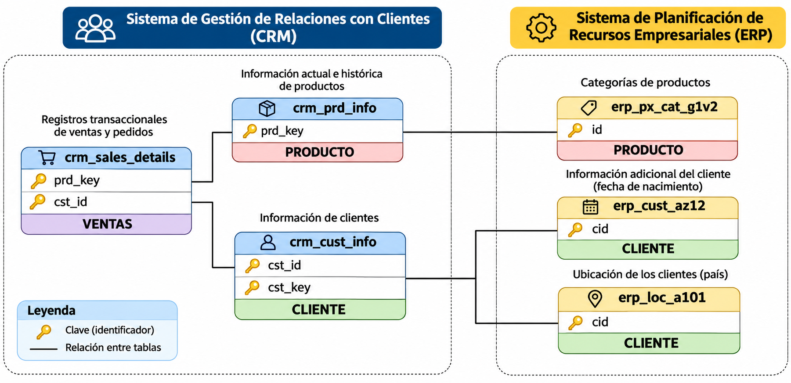

# Requisitos del proyecto

## Objetivo

Consolidar en SQL Server la información de ventas, clientes y productos que llega del CRM y del
ERP, para poder generar reportes y análisis sobre un solo modelo de datos.

## Alcance

- Se trabaja con la versión más reciente de cada fuente.
- No se requiere historización ni SCD tipo 2.
- El consumo final es por consultas SQL y herramientas de BI.

## Fuentes de datos

Los datos son seis archivos CSV en UTF-8, separados por coma y con encabezado, ubicados en
`01_datasets/`.

**CRM** (`01_datasets/source_crm/`)

- `cust_info.csv`: datos maestros del cliente (identificador, número, nombre, estado civil,
  género y fecha de alta).
- `prd_info.csv`: productos con su identificador, clave, nombre, costo, línea y vigencias.
- `sales_details.csv`: ventas y pedidos con producto, cliente, fechas, monto, cantidad y precio.

**ERP** (`01_datasets/source_erp/`)

- `CUST_AZ12.csv`: fecha de nacimiento y género del cliente.
- `LOC_A101.csv`: país del cliente.
- `PX_CAT_G1V2.csv`: categoría, subcategoría y mantenimiento de los productos.

### Relaciones entre fuentes

- `crm_cust_info.cst_key` con `CUST_AZ12.cid` (quitando el prefijo `NAS`) y con `LOC_A101.cid`
  (quitando los guiones).
- `crm_cust_info.cst_id` con `crm_sales_details.sls_cust_id`.
- `crm_prd_info.prd_key`, tomando la parte posterior al guion, con
  `crm_sales_details.sls_prd_key`.
- `crm_prd_info.cat_id`, que son los primeros cinco caracteres de `prd_key` cambiando `-` por
  `_`, con `PX_CAT_G1V2.id`.

## Requisitos funcionales

1. Importar los seis CSV a la capa Bronze sin transformaciones.
2. Cargar Bronze con estrategia full load (truncar y cargar) desde un procedimiento almacenado.
3. Limpiar y estandarizar en Silver: nulos, espacios, duplicados, fechas inválidas, géneros y
   estados civiles.
4. Corregir las inconsistencias de ventas: `sales = quantity × price`, precios y cantidades no
   positivos, fechas de envío y vencimiento.
5. Integrar CRM y ERP en un esquema en estrella en Gold.
6. Exponer Gold con las vistas `dim_customers`, `dim_products` y `fact_sales`.
7. Generar claves subrogadas para las dimensiones.
8. Documentar requisitos, arquitectura, convenciones y catálogo de datos.
9. Mantener el proyecto versionado en Git con commits descriptivos.

## Requisitos no funcionales

- **Idempotencia:** los scripts se pueden ejecutar varias veces sin duplicar datos ni objetos.
- **Trazabilidad:** Bronze conserva los datos como llegan, con los nombres y tipos originales.
- **Rendimiento:** carga por lotes con `BULK INSERT` y `TABLOCK`; Gold se resuelve con vistas.
- **Mantenibilidad:** convenciones de nombres uniformes y scripts separados por capa.
- **Portabilidad:** la ruta de los datasets está centralizada y documentada.

## Reglas de calidad

- `cst_id` nulo o vacío: se excluye el registro.
- `cst_id` duplicado: se conserva el de `cst_create_date` más reciente.
- Nombres y apellidos: se aplica `TRIM`.
- Estado civil o género desconocido: se estandariza a `n/a`.
- Fecha de nacimiento futura o anterior a 1926: se reemplaza por `NULL`.
- `prd_cost` nulo o negativo: se reemplaza por `0`.
- `prd_end_dt` incoherente: se recalcula como el día anterior al siguiente `prd_start_dt`.
- Fecha de venta con formato numérico inválido: se convierte a `NULL`.
- `sls_sales` nulo, menor o igual a cero, o distinto de `quantity × price`: se recalcula.
- `sls_price` nulo o menor o igual a cero: se deriva de `sales / quantity`.
- País abreviado (`US`, `DE`): se estandariza al nombre completo.

## Criterios de aceptación

1. Las tablas `bronze.*` tienen exactamente las filas de los CSV, sin rechazos.
2. `silver.crm_cust_info` no tiene `cst_id` nulos ni duplicados.
3. En `silver.crm_sales_details` se cumple `sls_sales = sls_quantity * sls_price` en todas las
   filas.
4. No hay `prd_end_dt` anteriores a `prd_start_dt`.
5. `gold.fact_sales` no tiene claves de producto ni de cliente huérfanas.
6. Los scripts de `04_tests/` terminan en estado PASS.
