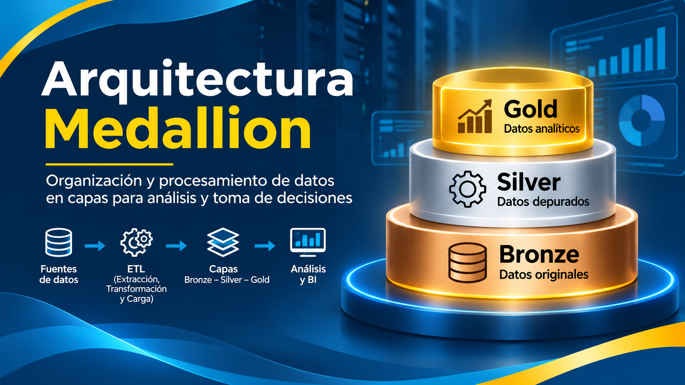

# Data Warehouse con Arquitectura Medallion

Proyecto de ISW623. Es un data warehouse en SQL Server que integra la información de ventas,
clientes y productos de dos sistemas de origen (CRM y ERP) y la organiza en las capas Bronze,
Silver y Gold.

Repositorio: <https://github.com/Deyner2005/sql-data-warehouse-project>



## Estructura

```
00_setup/      scripts para preparar el entorno
01_datasets/   archivos CSV de origen
02_docs/       documentación
03_scripts/    scripts SQL organizados por capa
04_tests/      validaciones de calidad
```

## Ejecución

La forma más rápida de crear la base, cargar las tres capas y validar es un solo comando:

```powershell
powershell -ExecutionPolicy Bypass -File "00_setup\run_all.ps1"
```

Si se prefiere hacerlo paso a paso, el orden y los requisitos de conexión están en
[00_setup/README.md](00_setup/README.md).

## Resultados

| Objeto | Filas |
|---|---|
| `bronze.crm_cust_info` | 18 494 |
| `bronze.crm_prd_info` | 397 |
| `bronze.crm_sales_details` | 60 398 |
| `bronze.erp_cust_az12` | 18 484 |
| `bronze.erp_loc_a101` | 18 484 |
| `bronze.erp_px_cat_g1v2` | 37 |
| `silver.crm_cust_info` | 18 484 |
| `silver.crm_prd_info` | 397 |
| `silver.crm_sales_details` | 60 398 |
| `gold.dim_customers` | 18 484 |
| `gold.dim_products` | 295 |
| `gold.fact_sales` | 60 398 |

El monto total vendido es 29 356 250. Las validaciones de calidad pasaron completas:
20 de 20 en Silver y 14 de 14 en Gold, con el detalle en el
[informe de calidad](02_docs/data_quality_report.md).

## Documentación

- [Requisitos](02_docs/requirements.md)
- [Arquitectura](02_docs/architecture.md)
- [Convenciones de nombres](02_docs/naming_conventions.md)
- [Catálogo de datos](02_docs/data_catalog.md)
- [Calidad de datos](02_docs/data_quality_report.md)

## Autor

Deyner Ramirez — ISW623
